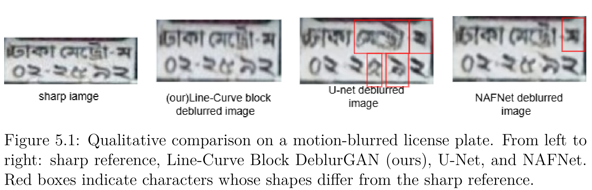

# Bangla License Plate Detection and Deblurring

A research project on detecting tilted or rotated Bangla vehicle license plates and restoring blurred plate crops using deep learning.

> **Related thesis:** *Multi-staged Deep Learning Framework for Detection and Restoration of Motion-Blur and Distorted Bangla License Plates* (BRAC University, 2026). This is a team research project. Please consult the approved thesis for the full methodology and research context.

## Research Contributions

- **Dataset development:** we created and prepared the dataset used in this research. The image collection, annotations, and preprocessing support experiments in oriented license-plate localization and image restoration.
- **Oriented detection:** YOLOv8m-OBB was trained to localize tilted or rotated Bangla license plates using oriented bounding boxes, helping produce plate crops for restoration.
- **Modified deblurring architecture:** The proposed Line-Curve Block DeblurGAN adds parallel horizontal (1 × 7), vertical (7 × 1), and deformable-convolution branches. The branches are fused, with channel attention and a residual formulation, to model directional and curved details in Bangla plate characters.
- **Multi-stage workflow:** The research combines plate localization, crop rectification, and image deblurring. Character recognition/OCR is **not included** in the implemented scope described by the thesis.

## Dataset

[**[Browse the dataset on Roboflow]([https://app.roboflow.com/thamed-ahasan-rakin/bengali-vehicle-images-made-for-yolov8m-obb/browse?queryText=&pageSize=100&startingIndex=0&browseQuery=true](https://universe.roboflow.com/thamed-ahasan-rakin/bengali-vehicle-images-made-for-yolov8m-obb))**](https://universe.roboflow.com/thamed-ahasan-rakin/bengali-vehicle-images-made-for-yolov8m-obb

**[Browse the dataset on Roboflow](https://universe.roboflow.com/thamed-ahasan-rakin/bengali-vehicle-images-made-for-yolov8m-obb)**
)

The thesis describes experiments using 1,991 clean license-plate images, with synthetic defocus-blur and motion-blur samples generated for paired restoration experiments. The reported restoration setup used an 80%/10%/10% train/validation/test split based on clean images, with paired samples generated for the blur conditions.

Dataset access and reuse depend on the Roboflow project's availability settings and applicable privacy, licensing, and research permissions. Do not redistribute images or annotations without the necessary rights.

## Reported Results

The figures below are transcribed from the thesis. Detection results are explicitly reported as **validation results**. The thesis labels the restoration-model comparison in Table 5.3 as **validation performance**; confirm the evaluation split before describing these values as test results.

### YOLOv8m-OBB detection

| Metric | Reported validation result |
|---|---:|
| Precision | 97.4% |
| Recall | 98.5% |
| mAP@0.5 | 99.3% |
| mAP@0.5:0.95 | 90.3% |

These are detection metrics, not character-recognition/OCR accuracy.

### Deblurring-model comparison

| Model | PSNR (dB) ↑ | SSIM ↑ | MAE ↓ |
|---|---:|---:|---:|
| Pix2Pix | 27.32 | 0.8477 | 7.80 |
| DeblurGAN-v1 | 27.53 | 0.8316 | 7.68 |
| DeblurGAN-v2 | 29.19 | 0.8878 | 6.18 |
| FMD-cGAN | 29.80 | 0.8962 | 5.96 |
| DRSN-GAN | 29.98 | 0.9059 | 5.83 |
| **Line-Curve Block DeblurGAN (proposed)** | **31.81** | **0.9272** | **4.95** |
| U-Net | 32.32 | 0.9310 | 4.42 |
| NAFNet | 33.92 | 0.9443 | 3.75 |

Higher PSNR and SSIM are better; lower MAE is better. The proposed model improves on the original DeblurGAN-v2 in this reported comparison, while U-Net and NAFNet obtain better numerical image-quality metrics. The proposed architecture is presented as a structure-aware GAN-based approach, not as the best model on every metric. comparison of our proposed model with u-net and NAFNet  

### Results by blur type

| Blur type | PSNR (dB) ↑ | SSIM ↑ | MAE ↓ |
|---|---:|---:|---:|
| Defocus blur | 33.70 | 0.9466 | 4.00 |
| Motion blur | 29.92 | 0.9077 | 5.89 |

The thesis reports weaker results for motion blur than for defocus blur. It also notes limitations including primarily synthetic blur, one fixed data split, and limited validation on real camera blur and other real-world degradations.

## Qualitative Results

The thesis includes a qualitative comparison of a sharp reference plate, the proposed Line-Curve Block DeblurGAN, U-Net, and NAFNet. The comparison discusses character-shape fidelity as well as visual sharpness.

## Repository Contents

The repository contains research notebooks, project dependencies, and a folder for qualitative restoration results.

- [Research notebooks](https://github.com/thamed-ahasan-rakin/bangla-license-plate-detection-deblurring/tree/main/notebooks)
- [Qualitative results](https://github.com/thamed-ahasan-rakin/bangla-license-plate-detection-deblurring/tree/main/results/qualitative)
- [Common requirements](https://github.com/thamed-ahasan-rakin/bangla-license-plate-detection-deblurring/blob/main/requirements-common.txt)

The notebooks require local dataset paths and compatible accelerator-specific PyTorch installations. The current experiments use different accelerator paths; consult each notebook before setting up an environment. Dataset files and trained checkpoints are not included in this repository.

## Reproducibility and Responsible Use

- Report results with the corresponding split, configuration, and checkpoint details; do not present validation metrics as test metrics.
- Do not claim OCR accuracy or a fully evaluated end-to-end recognition system, because OCR is outside the implemented scope described in the thesis.
- Do not publish private data, credentials, student IDs, or vehicle-plate images without appropriate permission.
- Confirm with the project team and supervisor that the code, results, and any thesis-derived figures are approved for public release.

## Related Academic Work

**Thesis title:** *Multi-staged Deep Learning Framework for Detection and Restoration of Motion-Blur and Distorted Bangla License Plates*.

The thesis is a team submission to the Department of Computer Science and Engineering, BRAC University (2026). Add a public thesis link here only if the approved thesis is permitted to be shared publicly.
